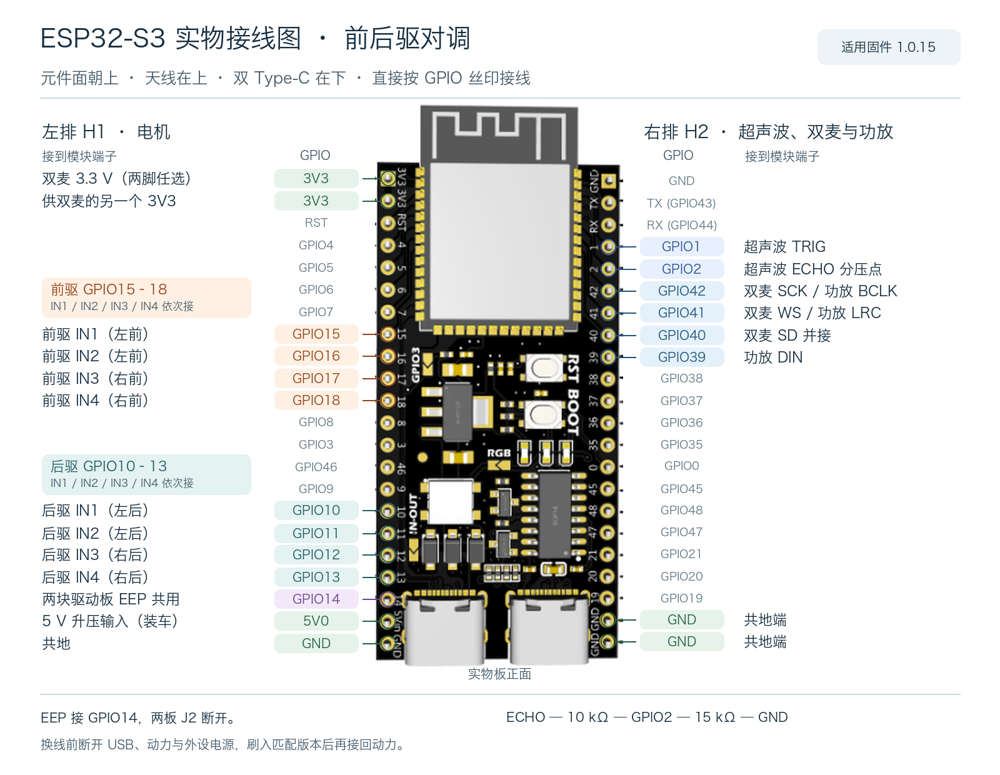
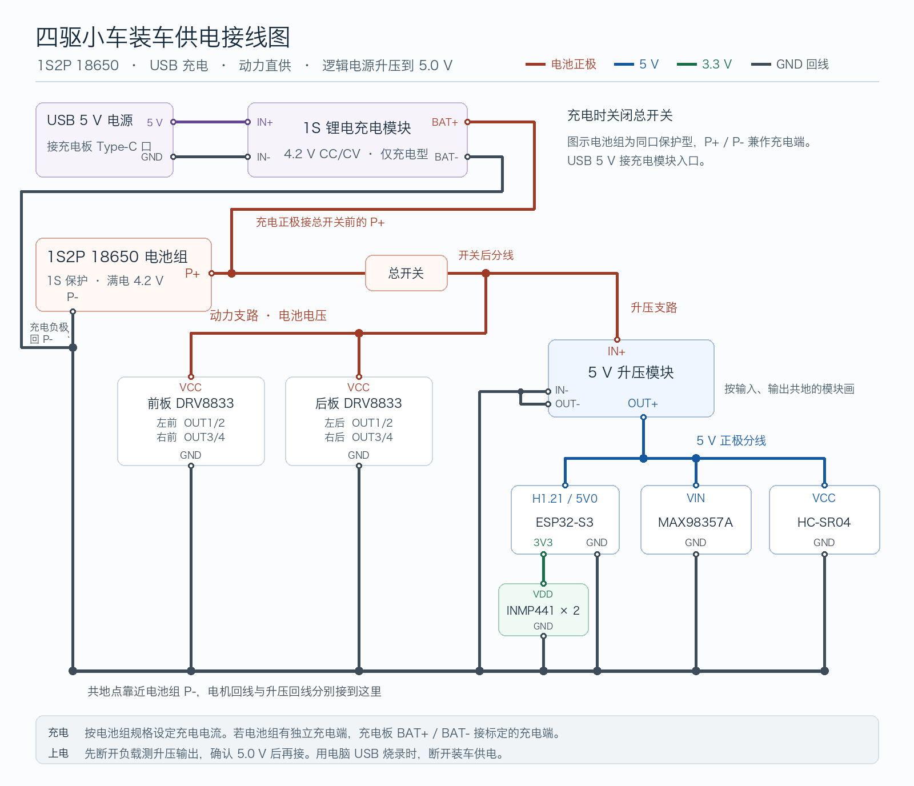

# 四驱小车接线

适用 ESP32-S3 N16R8、两颗 INMP441、3070 喇叭配 MAX98357A、HC-SR04，以及装车后的四个 TT 电机、两块 HW-627 DRV8833 和 1S2P 18650 电池组。

**这份接线对应固件 1.0.15。** 从 1.0.14 升级时，对调前、后驱动板接往 ESP32 的两组 `IN1–IN4` 信号线，前板接 `GPIO15–18`，后板接 `GPIO10–13`。两块板的 `EEP` 接 `GPIO14`。若旧接线还把 `EEP` 接在 `GPIO16`，先将它移到 `GPIO14`。换线时拔掉 USB，断开动力与外设电源。换线并刷入新版后，先用 USB 验证测距，再架空车轮接入动力测试。

## 洞洞板装配图

[下载 1.0.15 A3 装配图 PDF](perfboard-layout-1.0.15.pdf)。正面上半部 `J05` 接前驱，下半部 `J06` 接后驱，背面图标有跳线两端的焊点坐标。

装配图中的 `EEP` 对应经通断确认的驱动使能脚 `nSLEEP`。接 `GPIO14` 前，两块驱动板的 `J2` 都须断开。

使用 2.54 mm 独立焊盘洞洞板，至少预留连续 31 列 × 24 行。图纸为项目开发板的参考排布，先把两排母座套在 ESP32-S3 上干插核对，再焊。XH 插座以尾线落孔。从元件面翻到焊接面时保持天线朝上，孔号沿用正面定义。

## ESP32-S3 排针定位

将开发板元件面朝上、天线朝上、两个 Type-C 口朝下。**接线时优先看实物丝印和彩图标出的焊孔。** 表中 `H1`、`H2` 的第几脚是从天线端往下数的排针位置。左排丝印 `14` 是 `GPIO14`，紧挨着 `5V0` 的上方。右排丝印 `1` 是 `GPIO1`，在 `RX` 的下一脚。

| 排针位置，从天线端数 | 左排 `H1` 丝印，从上到下 | 右排 `H2` 丝印，从上到下 |
| --- | --- | --- |
| 1 至 3 | `3V3`、`3V3`、`RST` | `GND`、`TX (GPIO43)`、`RX (GPIO44)` |
| 4 至 7 | `4`、`5`、`6`、`7` | `1`、`2`、`42`、`41` |
| 8 至 11 | `15`、`16`、`17`、`18` | `40`、`39`、`38`、`37` |
| 12 至 15 | `8`、`3`、`46`、`9` | `36`、`35`、`0`、`45` |
| 16 至 20 | `10`、`11`、`12`、`13`、`14` | `48`、`47`、`21`、`20`、`19` |
| 21 至 22 | `5V0`、`GND` | `GND`、`GND` |

左排的后驱、前驱各成一束，右排的音频和超声波各成一束。两颗麦克风用到的 `3V3` 从左排沿板边绕到外设侧，线束绕开天线。功放和超声波各从 5 V 分线端取电，各模块共地。

这块板的 `USB-ISP` 口经 CH340C 接 UART0，烧录和查看 **115200** 波特的串口日志时优先用这个口。`USB-OTG` 口走 ESP32-S3 原生 USB。原理图中 `H1.21 / 5V0` 经 D2 向板内的 `VBUS` 供电，J1 跨接在 D2 两端。USB 供电桌测时把 **`5V0` 排针留空**，外设的 5 V 由独立电源直接提供。

## USB 桌面测试接线

电脑经 USB 给 ESP32 上电。两颗 INMP441 由开发板 3.3 V 供电，MAX98357A 和 HC-SR04 由独立稳压 5 V 电源供电。独立 5 V 的负极与 ESP32 的 GND 相连，正极只接外设。接线、换线时先断开 USB 与外设电源。确认接线后先给 ESP32 上电，再开外设 5 V。关机时先断外设 5 V，再拔 USB。

| 模块端子 | 接到 ESP32 或电源 | 备注 |
| --- | --- | --- |
| 两颗 INMP441 `VDD`（资料也写 `VCC`）、`GND` | `3V3`、`GND` | 每颗麦的电源端就近接一只 0.1 µF 去耦电容，模块已带时可沿用 |
| 两颗 INMP441 `SCK`、`WS` | `GPIO42`、`GPIO41`（H2 第 6、7 脚） | 两颗麦与功放共用时钟 |
| 两颗 INMP441 `SD` | `GPIO40`（H2 第 8 脚） | 两颗麦的 `SD` 并在同一数据线上，共接一只 100 kΩ 到 GND |
| 左麦 `L/R`、右麦 `L/R` | 左麦接 `GND`，右麦接 `3V3` | 按车头朝前时车体的左右对应安装 |
| MAX98357A `BCLK`、`LRC`、`DIN` | `GPIO42`、`GPIO41`、`GPIO39`（H2 第 6、7、9 脚） | 功放 `DIN` 接 ESP32 播放输出，功放的 `SD/EN` 按模块默认使能接法 |
| MAX98357A `VIN`、`GND` | 稳压 `5V`、共地 | 首次测试先用低音量，核对喇叭标注的阻抗和额定功率 |
| MAX98357A `SPK+`、`SPK−` | 喇叭两根线 | 两端都是桥接输出，`SPK−` 勿接系统 GND |
| HC-SR04 `VCC`、`GND` | 稳压 `5V`、共地 | 先接电源与参考地 |
| HC-SR04 `TRIG` | `GPIO1`（H2 第 4 脚） | 若模块无法可靠识别 3.3 V 触发电平，补电平转换 |
| HC-SR04 `ECHO` | **分压后接 `GPIO2`（H2 第 5 脚）** | `ECHO — 10 kΩ — GPIO2 — 15 kΩ — GND`，5 V 回波分到约 3.0 V |

INMP441 每声道输出 24 位有效数据，每个立体声帧需要 64 个 SCK。固件用 Philips I²S、16 kHz、左右各 32 位时隙，两个麦按 `L/R` 分别在自己的时隙驱动同一根 `SD` 线。`GPIO39` 单独向功放输出数据。[固件引脚](../main/robot.h) · [I²S 初始化](../main/audio.c) · [INMP441 手册，第 8、11、15 页](https://invensense.tdk.com/wp-content/uploads/2015/02/INMP441.pdf) · [MAX98357A 手册](https://www.analog.com/media/en/technical-documentation/data-sheets/max98357a-max98357b.pdf) · [HC-SR04 手册](https://cdn.sparkfun.com/datasheets/Sensors/Proximity/HCSR04.pdf)

### 桌面验收

1. 先只接 ESP32，用串口和配网热点打开后台。两颗麦接好后，在左、右侧分别靠近说话，确认「双麦测试」里相应侧的 RMS 有明显变化。
2. 接上功放和喇叭，点「喇叭测试音」，确认能听到短音，ESP32 没有重启。
3. 接上超声波和分压，拿宽纸板在正前方约 40–80 cm 来回移动，确认「超声波测距调试」的距离跟着变化。
4. 联网配置 DeepSeek Key 后，点「手动听一句」，再用网页当前选择的唤醒词测试回答和播报中打断。以上步骤保持电机锁定。行驶、避障与自动建图等底盘装好再测。[配网和语音步骤](../README.md#首次配网与语音)

## 两块 HW-627 驱动四轮

| 驱动板 | 左排 `H1` 脚位 | 输入接 ESP32 | 输出接电机 |
| --- | --- | --- | --- |
| 前板 A 路 | 第 8、9 脚 | `IN1 → GPIO15`、`IN2 → GPIO16` | `OUT1/OUT2 → 左前` |
| 前板 B 路 | 第 10、11 脚 | `IN3 → GPIO17`、`IN4 → GPIO18` | `OUT3/OUT4 → 右前` |
| 后板 A 路 | 第 16、17 脚 | `IN1 → GPIO10`、`IN2 → GPIO11` | `OUT1/OUT2 → 左后` |
| 后板 B 路 | 第 18、19 脚 | `IN3 → GPIO12`、`IN4 → GPIO13` | `OUT3/OUT4 → 右后` |

- 两块板的 `VCC`（芯片 `VM`）接电机动力支路，`GND` 共地。每个电机独占一个 H 桥，电机的两根线都接对应的 `OUT`。

### EEP、J2 和 ULT

按这批 HW-627 的背面图，右上角是 `EEP`，右下角是 `ULT`，`J2` 是上方靠近 `EEP` 的两个小焊盘。前板的 `EEP` 已实测通到 DRV8833 芯片第 1 脚 `nSLEEP`，高电平启用，低电平休眠。`ULT` 对应第 8 脚 `nFAULT`，为开漏故障输出。商品图的文字把两者写反了。后板先用万用表在断电时单独确认 `EEP` 通到芯片第 1 脚，再接线。[HW-627 公开板图](https://github.com/robopoly-pi/Kit_Prisme_NEW/blob/main/symbol/kitprisme.kicad_sym#L893-L1010) · [TI 引脚表](https://www.ti.com/lit/ds/symlink/drv8833.pdf#page=3)

| 用途 | `J2` | `EEP` | `ULT` |
| --- | --- | --- | --- |
| 正式装车 | 两块板的焊桥都断开 | 两块板并接 ESP32 的 `GPIO14`（`H1` 第 20 脚） | 两块板都留空 |
| 临时台架排查 | 将待测板的焊桥短接，让驱动板持续唤醒 | 从 `GPIO14` 拔下待测板的 `EEP` 线。前板在 5 V 供电时短接 `J2`，其 `EEP` 实测约 5 V | 留空 |

前板如果仍短接着 `J2`，先断开电池和 USB，去掉锡桥，确认两个焊盘之间已经断开。连接 `GPIO14` 前，保持 `EEP` 线拔开，给驱动板上电测 `EEP` 对板上 `GND`，应接近 0 V。若仍测到电机供电电压，先排查焊桥和板上上拉。核对后再断电接线，两块驱动板与 ESP32 共地。可在共用使能线上加一只 10 kΩ 下拉到 `GND`。

正式装车后，锁定待机时 `EEP` 应接近 0 V，启用电机后约为 3.3 V。台架测试完，恢复 `J2` 断开再接回 `GPIO14` 到 `EEP` 的线。

固件提供测距拦截、手动急停和动作超时。单轮堵转检测还需要电流或轮速反馈。若要使用 DRV8833 每路硬件限流，检查实物 `AISEN`、`BISEN` 是否各自经过采样电阻接地。直接接地的板仍有芯片过流保护，具体堵转表现要按 TT 电机和模块实测。[DRV8833 限流与保护，第 10–11 页](https://www.ti.com/lit/ds/symlink/drv8833.pdf#page=10)

## 1S2P 18650 装车供电

使用带 **1S 过充、过放、过流和短路保护**的成品 1S2P 18650 电池组。对常见的 4.2 V 满充锂离子电芯，电池组标称约 3.6–3.7 V，充满约 4.2 V，容量是两颗电芯之和。选用厂商配组的电池组，以其标注的持续放电、峰值持续时间和允许充电电流为准。

- **充电。** 将 USB 5 V 插到 **4.2 V、1S、仅充电型 CC/CV 模块**的 Type-C 口。图按充放电同口的保护电池组绘制。充电板 `BAT+` 接总开关前的电池组 `P+`，`BAT-` 接电池组 `P-`。若电池组有独立充电端，充电板的两根输出线分别接厂商指定的充电正负端，小车仍从受保护的放电端取电。按电池组规格设置充电电流，**充电时关总开关**，让充电模块单独给电池充电。充电口与 ESP32 烧录口分开。[独立充电器与负载的接法](https://www.microchip.com/en-us/application-notes/an1149)
- **动力。** 电池组 `P+` 直接接总开关，开关输出用一个共通分线端子接两块 DRV8833 的 `VCC` 和升压模块的 `IN+`。先确认 TT 电机的额定电压覆盖电池组满电电压，并验证电池低压、四轮同时启动时驱动板仍正常。按实测起步和堵转电流核对 H 桥与驱动板的散热能力，保护板、开关、接插件和导线按整机负载匹配。[DRV8833 电流与封装规格](https://www.ti.com/product/DRV8833)
- **5 V。** 按电池低压时升压模块能持续输出的电流选型，空载调到 5.0 V，再测 Wi-Fi 与功放同时运行时的 5 V 和开发板 3.3 V。估算升压模块输入电流时用 `5 V × 输出电流 ÷ (电池端电压 × 效率)`。例如 5 V 输出 1 A、电池端 3.2 V、效率 85% 时，升压支路约需 1.84 A，电机支路电流另计。装车用升压供电时拔掉 ESP32 的 USB，烧录时关闭或断开装车电源。5 V 接进 `5V0`，勿接 `3V3`。
- **走线。** 两条正电支路从总开关后分出，电机与升压的地线回到电池输出负极附近的共地点。电机回流避开麦克风线，驱动板和升压模块的去耦按各自资料布置，电机电源线尽量短。电池组靠底盘中间固定，用绝缘固定带和防滑垫，预留充电口与走线。给 18650 电池组预留独立的安装位置。

## 机械安装与上电顺序

1. 两个 INMP441 放在车头两侧，拾音孔中心距先用 **100 mm**。拾音孔朝向尽量一致并保持通畅。实测间距填进网页，喇叭放到另一端，减少直接耦合。
2. 超声波装在车头中央、探头朝前。相同地面条件下先放一块较宽的平板检验测距，再尝试椅腿、门边等障碍。近距离或侧面的障碍可能在探测范围之外。
3. 先只接逻辑供电，核对每条电源轨和 Echo 分压，再确认双麦、UART、喇叭和超声波。四轮架空后接入动力，在后台确认超声波回波有效且前方通畅，再启用电机，逐个点动并观察车轮。通过后再做低速地面标定和避障。

后台显示「PWM 输出失败」时，固件会停止输出、锁定电机，重启前无法重新启用。点动显示完成后，以车轮实际转动为准。

板级核对使用了提供的《esp32s3引脚定义图》《esp32s3开发板原理图》《inmp441接口定义》和《INMP441.pdf》。装配时以手中开发板和模块的实际丝印、焊桥状态为准。
